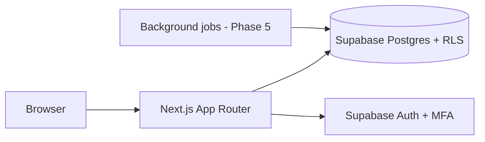

# DisputeOS
Credit repair platform with Personal and Agency modes. Results-driven, bilingual (EN/ES), compliance built in.
Not legal advice. Nothing here guarantees deletion of accurate items or any score outcome.

## Status
**Phase 1 (foundation)**: Next.js 15 + TypeScript strict + Tailwind, next-intl (EN/ES), Supabase SSR auth with
MFA gating, multi-tenant schema with RLS, field encryption, PII scrubbing, security headers, CI.
Phases 2–3 add the report parser/review (`/reports`), the dispute analyzer with bilingual letters (`/analysis`, sample data) and a demo `/dashboard`. Phase 4 starts with the mail adapter (`src/lib/mail`, mock by default). Remaining phases are the roadmap; open decisions are logged in `docs/DECISIONS.md`.

## Setup
```
npm install
cp .env.example .env.local   # fill in Supabase values
npm run dev
npm test
supabase start && supabase test db   # RLS tenant-isolation tests
```

## Architecture


## Compliance notes
- CROA contract/disclosure and 3-day cancellation flow: Phase 6.
- **Florida credit service organizations may need registration and a surety bond. Verify requirements and
  amounts with an attorney before taking paying clients.**

`/prototype` holds the original static UI demo (open `prototype/index.html`).
